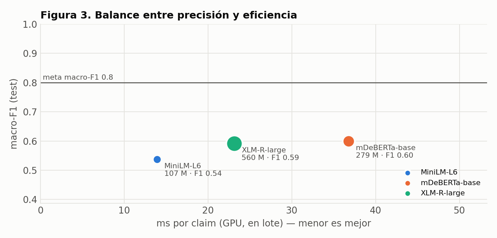

# Clasificación de claims de etiquetado con modelos preentrenados de Hugging Face

**ClaimCheck IA · Actividad 4 — Gestión de proyectos de inteligencia artificial (Universidad Tecmilenio)**  
Autor: Brandon Gilberto Imanol Retana Fuentes (AL07175444) · Maestría en Inteligencia Artificial · Octubre de 2026

Prototipo que compara tres modelos preentrenados de Hugging Face para clasificar, sin entrenamiento previo (*zero-shot*), los claims de etiquetas de alimentos en cuatro tipos. Cada tipo se revisa contra reglas distintas, así que la clasificación permite enviar cada claim al checklist correcto. El modelo propone y el revisor técnico decide.

> Organismo certificador ficticio: *CertiBajío, S.C.* El dataset no contiene etiquetas reales de clientes.

---

## 1. Caso de uso

| Clase | Qué declara | Ejemplo | Checklist al que se enruta |
|---|---|---|---|
| `NUTRIMENTAL` | Cantidad, presencia, ausencia o comparación de un nutrimento | *Sin azúcares añadidos* | Umbrales contra la tabla nutrimental |
| `SALUD` | Relación entre un nutrimento o alimento y la salud | *El calcio es necesario para el mantenimiento de los huesos* | Declaraciones autorizadas y evidencia |
| `AUSENCIA` | Ausencia de un alérgeno, aditivo o ingrediente que no es nutrimento | *Sin gluten* | Evidencia analítica y control de alérgenos |
| `MARKETING` | Calidad, origen, proceso, sabor o sostenibilidad | *Receta tradicional* | Veracidad, que no induzca a error |

**Rama de la IA:** procesamiento de lenguaje natural (clasificación zero-shot por inferencia de lenguaje natural, NLI).

## 2. Modelos comparados

| Clave | Model ID en el Hub | Arquitectura |
|---|---|---|
| MiniLM-L6 | [`MoritzLaurer/multilingual-MiniLMv2-L6-mnli-xnli`](https://huggingface.co/MoritzLaurer/multilingual-MiniLMv2-L6-mnli-xnli) | MiniLMv2, 6 capas (destilado) |
| mDeBERTa-base | [`MoritzLaurer/mDeBERTa-v3-base-xnli-multilingual-nli-2mil7`](https://huggingface.co/MoritzLaurer/mDeBERTa-v3-base-xnli-multilingual-nli-2mil7) | mDeBERTa-v3 base, 12 capas |
| XLM-R-large | [`joeddav/xlm-roberta-large-xnli`](https://huggingface.co/joeddav/xlm-roberta-large-xnli) | XLM-RoBERTa large, 24 capas |

Los tres resuelven la misma tarea y entienden español; difieren en tamaño para estudiar el balance entre precisión y eficiencia.

**Componentes del ecosistema Hugging Face usados:** *Models* (modelos y lectura de sus model cards por API), *Datasets* (carga y filtrado del CSV con la librería `datasets`), *Spaces* (demo en `src/app_gradio.py`) y las librerías `transformers`, `evaluate` y `huggingface_hub`.

## 3. Estructura del repositorio

```
clasificacion-claims-etiquetado/
├── README.md
├── requirements.txt
├── LICENSE
├── data/
│   ├── claims_etiquetado.csv        # dataset (240 claims)
│   ├── claims_etiquetado.xlsx       # mismo dataset + diccionario de datos, guía y resumen
│   └── README.md                    # ficha del dataset: origen, campos, reglas de etiquetado
├── notebooks/
│   └── BGIRF_Actividad_4_GPIA.ipynb               # cuaderno de Colab ejecutado en GPU T4
├── src/
│   ├── generar_dataset.py           # regenera el CSV idéntico (semilla 42)
│   ├── exportar_excel.py            # genera el .xlsx a partir del CSV
│   ├── comparar_modelos.py          # misma comparación que el notebook, como script
│   └── app_gradio.py                # demo para un Space de Hugging Face
├── results/                         # resultados de la ejecución en Colab
│   ├── metricas_modelos.csv         # tabla comparativa
│   ├── ...                          # demás tablas, resumen.json y entorno.json
│   └── figuras/                     # 6 figuras
└── docs/
    └── analisis_comparativo_modelos.docx      # reporte técnico comparativo
```

## 4. Entorno de ejecución

| Elemento | Valor |
|---|---|
| Plataforma | Google Colab con GPU **NVIDIA Tesla T4** (`Entorno de ejecución → Cambiar tipo de entorno → T4 GPU`) |
| Lenguaje | Python 3.10 o superior (ejecución reportada: Python 3.13.15) |
| Librerías | `transformers`, `datasets`, `evaluate`, `accelerate`, `huggingface_hub`, `sentencepiece`, `scikit-learn`, `pandas`, `matplotlib` (ver `requirements.txt`) |
| PyTorch | El que trae Colab con soporte CUDA (ejecución reportada: 2.11.0+cu130); no se fija versión para no romper la GPU |
| Semilla | 42 (dataset, partición y librerías) |
| Registro | Las versiones exactas, la GPU y el commit de cada modelo quedan en `results/entorno.json` |

Versiones de la ejecución reportada: `transformers` 5.18.0, `datasets` 4.8.5, `evaluate` 0.4.6, `huggingface_hub` 1.33.0 y `scikit-learn` 1.6.1. Commits de los modelos: MiniLM-L6 `0a71e92a98`, mDeBERTa-base `b5113eb38a`, XLM-R-large `b227ee8435`.

## 5. Pasos de ejecución

### En Google Colab (recomendado)

1. Abre el notebook: `Archivo → Abrir cuaderno → GitHub` y pega la URL de este repositorio, o sube `notebooks/BGIRF_Actividad_4_GPIA.ipynb`.
2. Activa la GPU: `Entorno de ejecución → Cambiar tipo de entorno de ejecución → T4 GPU → Guardar`.
3. (Opcional) Agrega tu token de Hugging Face en **Secrets** (ícono de llave) con el nombre `HF_TOKEN` y rol *Read*. Los modelos son públicos, así que el notebook también corre sin token.
4. Pon el dataset al alcance del notebook con una de estas opciones:
   - sube `data/claims_etiquetado.csv` cuando la celda de la sección 5 lo pida;
   - si el repositorio es público, define `URL_DATASET` con la URL *raw* del CSV;
   - o clona el repositorio en `/content` con `!git clone <url-del-repositorio>`.
5. `Entorno de ejecución → Ejecutar todas`. Tarda unos minutos; la mayor parte es la descarga de los modelos.
6. Al final se descarga `resultados_actividad4.zip`: descomprímelo en `results/` y guarda el notebook ejecutado (`Archivo → Descargar → .ipynb`) en `notebooks/`.

### En local (CPU o GPU propia)

```bash
pip install -r requirements.txt
python src/generar_dataset.py          # opcional: regenera data/claims_etiquetado.csv
python src/exportar_excel.py           # opcional: regenera el .xlsx
python src/comparar_modelos.py         # compara los tres modelos y escribe results/
python src/comparar_modelos.py --sin-cpu             # versión rápida (sin medir CPU)
```

## 6. Metodología

1. **Partición.** dev (71 claims, 30 %) solo para elegir el ajuste mínimo y el umbral; test (169 claims, 70 %) solo para las métricas finales. Estratificada por clase.
2. **Ajuste mínimo, sin reentrenar.** Por modelo se comparan en dev tres configuraciones de plantilla de hipótesis y descripción de clases (`base_en`, `es_cortas`, `es_descriptivas`) y se queda la de mayor macro-F1. Con ella se fija el umbral de confianza τ: el menor valor que logra al menos 90 % de exactitud en lo que se automatiza.
3. **Métricas en test.** Accuracy, precision, recall y F1 (macro y por clase), cotejadas con la librería `evaluate`; matriz de confusión; cobertura automatizable a τ.
4. **Eficiencia.** ms por claim en lote (GPU), p50 y p95 de un claim a la vez, ms por claim en CPU, VRAM pico, parámetros, tamaño en disco y horas de cómputo al volumen anual (86,400 claims).
5. **Regla de decisión, fijada antes de ejecutar.** Cumplir macro-F1 ≥ 0.80, recall de SALUD ≥ 0.90 y latencia ≤ 300 ms por claim. Entre los que cumplen y están a 0.02 o menos del mejor macro-F1, gana el más eficiente. Si ninguno cumple, se recomienda el de mayor macro-F1 como base para fine-tuning.

## 7. Resultados

Ejecución en Google Colab con GPU Tesla T4, partición test (169 claims). Se hicieron dos ejecuciones con predicciones y métricas idénticas; la tabla muestra la segunda, que es la del notebook. Tablas completas en `results/metricas_modelos.csv` y figuras en `results/figuras/`.

| Modelo | Accuracy | Precision | Recall | macro-F1 | Recall SALUD | ms/claim T4 (lote) | VRAM (MB) | Parámetros (M) |
|---|---|---|---|---|---|---|---|---|
| MiniLM-L6 | 0.550 | 0.679 | 0.544 | 0.537 | 0.810 | 13.9 | 435 | 107 |
| **mDeBERTa-base** | 0.609 | 0.659 | 0.623 | **0.599** | **0.857** | 36.8 | 630 | 279 |
| XLM-R-large | 0.615 | 0.718 | 0.610 | 0.592 | 0.286 | 23.1 | 2,187 | 560 |

- **Ajuste mínimo:** la plantilla de hipótesis en español subió el macro-F1 en test +0.09 (MiniLM), +0.04 (mDeBERTa) y +0.14 (XLM-R) frente a la plantilla por defecto en inglés.
- **Umbral de confianza:** solo MiniLM alcanzó 90 % de exactitud en dev (τ = 0.50: automatizaría el 20 % de test con 97 % de exactitud).
- **Variación de latencia entre ejecuciones:** MiniLM 3.2 → 13.9 ms, mDeBERTa 7.4 → 36.8 ms y XLM-R 23.0 → 23.1 ms por claim. Los modelos pequeños dependen más de la CPU de la máquina compartida de Colab, así que su latencia no es estable.
- **Latencia en CPU** (media de 20 claims): MiniLM 377 ms y XLM-R 1,810 ms. El valor de mDeBERTa (10,642 ms) es atípico, se repitió en las dos ejecuciones y su causa no se verificó; no se usó para decidir.



## 8. Conclusiones

- **Modelo recomendado: mDeBERTa-v3 base.** Tiene el mayor macro-F1 (0.599, apenas por encima de XLM-R, 0.592) y el mejor recall de SALUD (0.857), con 3.5 veces menos VRAM y la mitad de parámetros que XLM-R large. En latencia no hay un ganador claro: ambos cumplen el límite en lote.
- **Ningún modelo cumple los umbrales en zero-shot** (macro-F1 ≥ 0.80 y recall de SALUD ≥ 0.90). El recomendado se usa como base para fine-tuning con claims reales anonimizados y, mientras tanto, solo sugiere la clase con revisión humana del 100 %.
- **Más allá de mDeBERTa, más tamaño no mejoró el macro-F1.** XLM-R large duplica sus parámetros y no lo supera. La latencia no restringe: en lote, el más lento usa 0.88 h de T4 al año.
- **La accuracy no basta.** XLM-R tiene la mayor accuracy (0.615), pero envía 30 de 42 claims de salud a NUTRIMENTAL, donde se saltarían la verificación de declaraciones autorizadas.
- **Reproducibilidad:** con la misma semilla, el mismo dataset y los modelos fijados por commit, las predicciones fueron idénticas en dos ejecuciones.
- **Límite principal:** el dataset fue redactado por el autor. Antes de un piloto debe validarse con claims reales anonimizados.

El análisis completo está en `docs/analisis_comparativo_modelos.docx`.

## 9. Licencia

Código bajo licencia MIT (ver `LICENSE`). El dataset es material académico propio. Los modelos conservan la licencia de su *model card* en Hugging Face.
